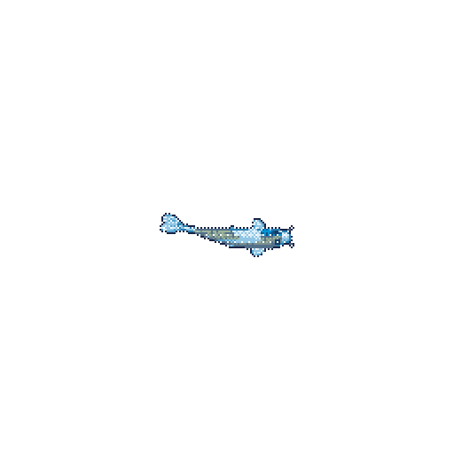

# Hi, I'm Kody Almizyed. 

I'm a sophomore at the **University of Wisconsin-Madison** pursuing a B.S. in *Mechanical Engineering.* I'm interested in the design and propulsion of <ins>rockets and aircraft</ins>, and the design of <ins>robots</ins> for non-humanoid tasks like space travel or underwater exploration.

I'm a member of **Wisconsin Autonomous Underwater Vehicles (WAUV)**, a team building a fully autonomous submarine capable of manipulating objects and firing torpedoes. As the club's <ins>Mechanisms Lead</ins>, I'm responsible for the prototyping, manufacturing, and test development for the AUV's external mechanisms, including the gripper mechanism, torpedo launchers, and tag droppers. We will be debuting as UW-Madison's *first* competitive marine robotics team at RoboSub 2027.

Recently, I also joined Wisconsin Aerospace (formerly SAE Aero) as a design engineer. I'm working on the structural optimization of the aircraft, including ownership of CAD, simulation, prototyping, testing, and iteration of designs.

# My koi pond:
My koi is fed when I am more active on my github. I don't often do a lot of programming projects though, so he may be a bit hungry. ;)

