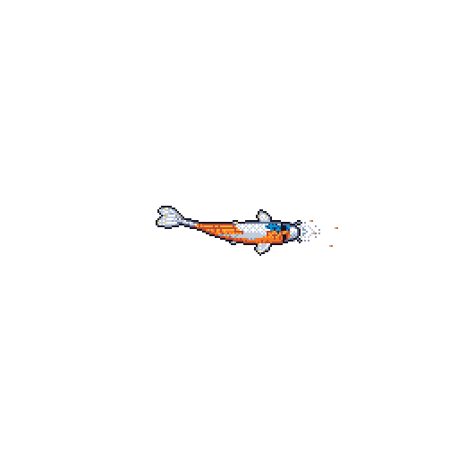

# Hi, I'm Kody Almizyed

I'm a mechanical engineering sophomore at the **University of Wisconsin–Madison**, earning a B.S. in Mechanical Engineering and a Certificate in Computer Sciences (May 2029). I design, build, and test mechanical systems, and I'm working toward a career in the space industry. I'm looking for a **summer 2027 internship in aerospace**.

## What I'm working on

**Wisconsin Autonomous Underwater Vehicles (WAUV), Mechanisms Lead**
I lead 15+ engineers through the design, manufacturing, integration, and testing of the mechanisms on our autonomous submarine, including the gripper, torpedo launchers, and tag droppers. I modeled and prototyped a tendon-actuated gripper that lifts hand-sized objects up to 6 kg, and I develop the test procedures that check each mechanism against competition requirements. We're debuting as UW–Madison's first competitive marine robotics team at RoboSub 2027.

**Wisconsin Aerospace (SAE Aero UW), Design Engineer**
I own the design, optimization, and manufacture of the aircraft's structural members. I validate designs with compressive load-frame testing and in-flight strain gage data, then use the results to guide each iteration.

**Previously: Mechanical Engineering Intern at AprilAire (Summer 2026)**
I diagnosed the root cause of zone damper motor failures, leading to a design change projected to recover $100K+ per year. I also resolved a barometric damper defect and built an Arduino and Python data acquisition tool for root-cause testing.

## What interests me

- Design and propulsion of rockets and aircraft
- Robots built for tasks humans can't easily do, such as space travel and underwater exploration

## Skills

**Engineering:** CAD, PTC Windchill, FMEA, strain gaging, rapid prototyping, 3D printing, Arduino, soldering
**Languages:** Python, C++, Java, JavaScript, Lua, Bash, Git

## Get in touch

- Portfolio: [dalmizyed.github.io](https://dalmizyed.github.io)
- LinkedIn: [linkedin.com/in/kodyalmizyed](https://www.linkedin.com/in/kodyalmizyed)
- Email: kodyalmizyed@outlook.com

## My koi pond:
My koi is fed when I am more active on my github. I don't often do a lot of programming projects though, so he may be a bit hungry. ;)

